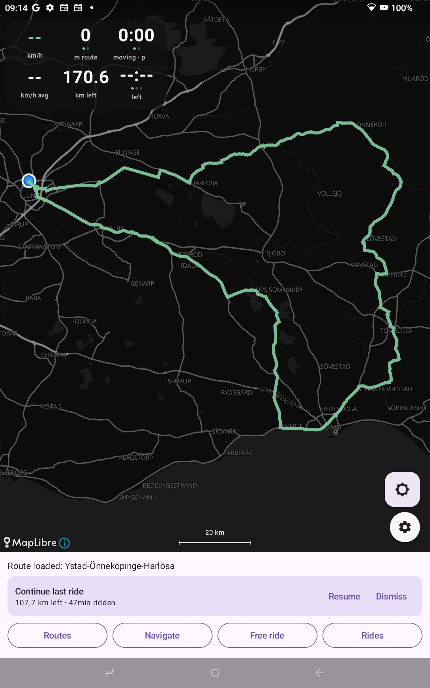
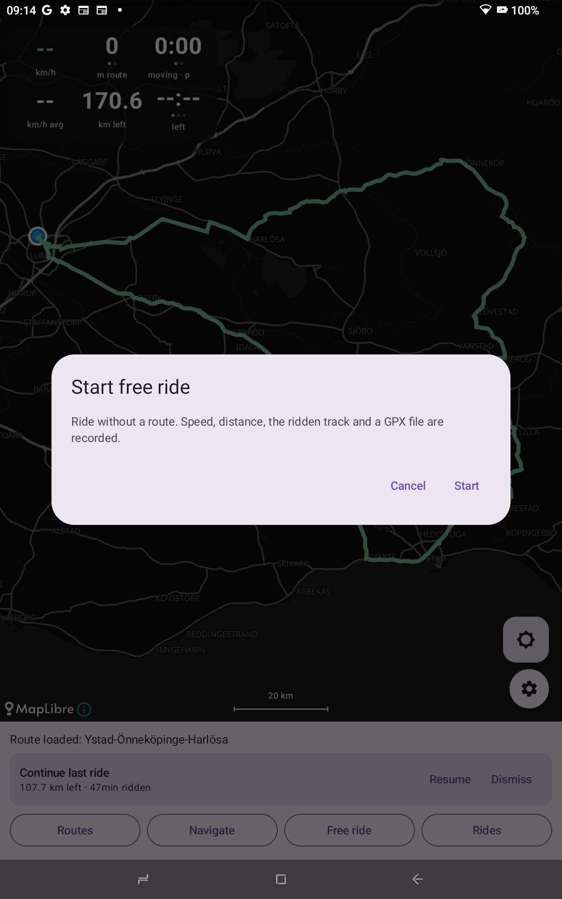
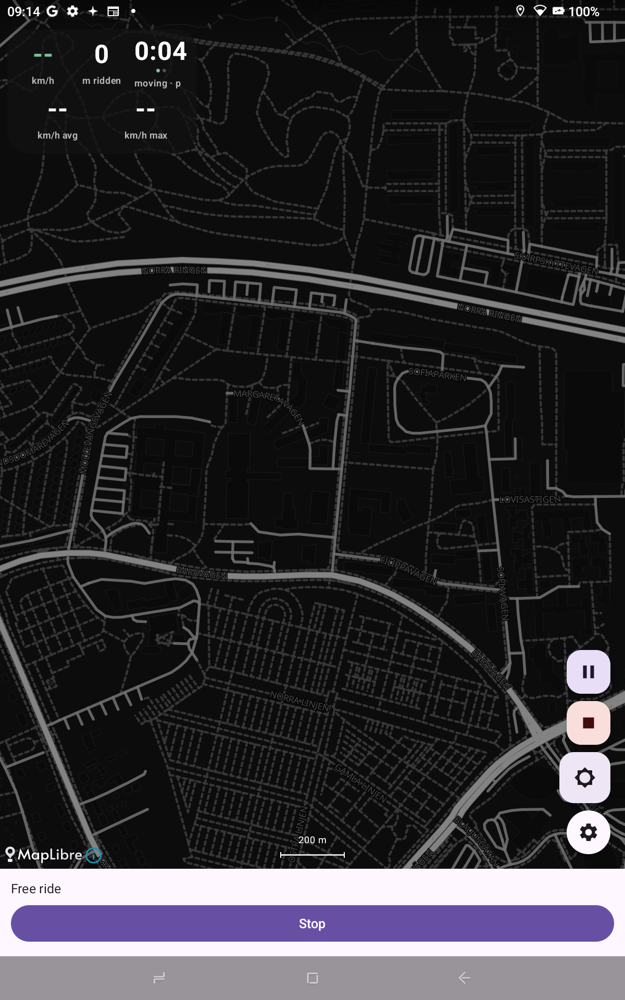
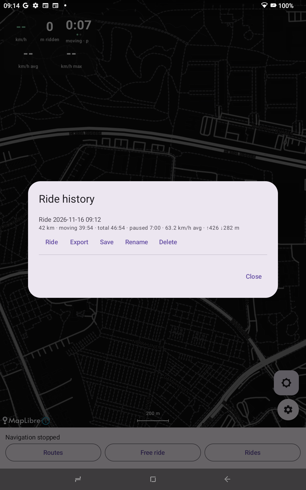
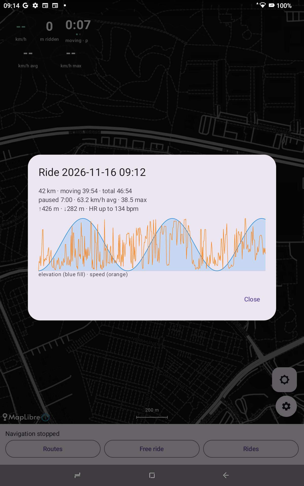

# Crazy Capy Randonneur

**Ride all day on one charge.** Crazy Capy Randonneur is an open-source,
voice-first bike GPS for Android that treats battery life as a first-class
feature. You load your own GPX route, slip the phone in your pocket, and let
your ears do the navigating — no accounts, no cloud, no ads.

> Required: Android **13 (API 33)** — minSdk 33, targetSdk/compileSdk 35.
>
> **Current release: [`v0.2.0`](https://github.com/zingo/Crazy_Capy_Randonneur/releases/tag/v0.2.0)** — see [Releases](#releases).

## Why it preserve battery

- **Screen off while riding** (screen stays awake only while actually moving; paused/stopped lets it sleep) – guidance is voice-first. A foreground service
  and a light wake lock keep GPS, navigation and speech running while the
  display sleeps — the single biggest win on an OLED phone.
- **GPS cadence setting** – choose 5 s (power-save), 3 s (normal) or 1 s (precise). Also a steady fix interval (no Play Services
  fused location, no cloud round-trips) is plenty for turn-by-turn guidance.
- **Prepare route offline** – one action per saved route (also offered when a
  route loads) downloads MapLibre offline regions in ~10 km corridor segments
  (1.5 km either side) and then pre-renders every turn preview and corridor tile
  it can in a single run, with a phase label, progress and cancel (map first, so
  previews use the cached tiles). Preparation runs in a foreground service, so
  closing the dialog or switching apps keeps it going; a low-importance
  notification shows the map/preview phase and progress and offers **Pause /
  Resume** and **Cancel**. Resuming skips completed segments and cached
  previews; cancel removes partial map regions. Notification permission is
  requested when preparation starts, but the work still runs if it is denied.
   Choose **Standard** (whole corridor at zoom
   8–14) or **Turn-focused** (whole corridor at 8–12 plus high zoom 13–14 in 1 km
   boxes around turns); the last choice is remembered and can be set under
   **Settings → Offline map detail**. **Advanced offline tuning** in Settings
   sets segment length (2–50 km, default 10), corridor padding (0.5–10 km,
   default 1.5), high-detail turn box (0.25–5 km, default 1) and the high-detail
   zoom ceiling (13–16, default 14); packs carry a tuning signature, so changing
   it replaces only that route's packs on the next prepare. There is no
   artificial turn cap; it skips
  phases that are already done, and if the preview pass is interrupted it
  reports how many turns were cached ("Pre-cached 34/347 · rest on next load")
  and resumes on the next run, skipping what's done. On the ride the HUD pops
  up instantly from those cached images with zero tile fetches — and no/less
  live rendering, so your radio stays quieter — and the map works without
  network. Packs use the saved route's stable library id, so renaming a route
  reuses its existing pack and previews instead of orphaning them; ad-hoc
  tracks (open-with/clipboard/share) fall back to a geometry hash. Segments are
  keyed by route, geometry hash, map style, detail strategy and segment number,
  so re-preparing reuses completed segments, replaces stale or partial ones and
  removes cancelled partial segments while leaving other routes and strategies
  intact; legacy name-keyed packs are matched by geometry and migrated on the
  next prepare. Turn/overview previews are invalidated when the route changes.
  **Settings → Offline map packs** groups a route's segments into one entry with
  the segment count, summed size, strategy, theme/style, tuning, date and status,
  shows the total vs cap, and can delete a route's segments or all packs. A
  route still in the library also gets **Refresh**, which deletes that group and
  starts a fresh prepare within the storage cap; a missing route shows **Route
  not found**, and metadata-less regions are labelled **Legacy / unknown** with
  their fallback name and can only be deleted. **Also prepare the other map
  theme** (dialog, remembered; **Settings → Offline map theme** sets the default
  Off/Always/Ask) downloads dark and light as separate regions so the map keeps
  rendering offline after switching theme. The prepare dialog also shows an
  estimated pack-size range (~low–high MB, still an estimate), segment and theme
  count, and the active tuning; a configurable **Offline storage cap** (MB, 0 = unlimited) checks total minus reclaimable bytes from
  this route's replaced segments plus the estimate, so re-preparing does not
  block on space it will free, and an over-cap warning reports both the used and
  reclaimable amounts without deleting packs. **Offline pack expiry** (days,
  0 = never) flags old packs in the manager with a **Delete expired** action;
  **Auto-delete expired offline packs** (default off) prunes expired groups once
  at app start and reports the count in the manager. Preparation state is
  persisted: if Android kills the app mid-prepare, a unique WorkManager job
  resumes the same route, strategy and theme choice when the network returns
  (and on the next launch), skipping completed segments and cached previews. In a controlled benchmark,
  showing a pre-cached preview cost ~1.4–2.5× less energy and ~6–8× less CPU
  than rendering it live (screen on/off), while warming only the map tiles made
  no measurable difference. On a ride the saved energy is small next to the
  display's draw; the bigger wins are much less CPU work and far fewer
  network/tile fetches (quieter radio, works offline) — see the
  [cache cost benchmark](docs/power/cache-bench.html).
- **Dark OLED map by default** – the dark tile style is the default; light is
  one tap away.
- **Map scale bar & compass** – a distance scale sits bottom-centre and tracks
  your zoom level; a compass appears top-right whenever the map is rotated and
  snaps back to north-up when tapped. Zoom with pinch — no on-screen buttons.
- **Toggleable extras** – the per-second live notification and the corner popup
  can each be switched off in Settings when you don't need them.

## Power measurements

We measure, so we can improve. The app can ride a fixed ghost route on real devices
while a ~1 kHz USB power meter records it; the results live in a committed
**[power baseline](https://zingo.github.io/Crazy_Capy_Randonneur/power/baseline.html)**
(colour-coded by level and device, click a column to sort), and the method (meter,
harness, presets, warm-up, charging handling, reproducibility) is documented in
the [power-measurement toolkit](tools/README.md).

This is the groundwork, not the verdict. Results so far: whether the dark map
beats the light one is still being measured (TODO). For pre-caching, a
controlled benchmark shows a pre-cached preview uses ~1.4–2.5× less energy and
~6–8× less CPU than a live render; on a ride the energy difference is small
beside the screen, while the CPU and network/tile-fetch savings are the
practical win — see the
[cache cost benchmark](docs/power/cache-bench.html). That benchmark hook is
debug-build-only; release builds carry none of it.

## Highlights

- **Voice turn-by-turn** – speed-aware advance notices ("turn right in 500
  meters" ~50 s before the turn), a near-turn notice that also names the
  following turn, periodic "go on for x.x km" heads-up, and off-route /
  back-on-route prompts.
- **Turn beeps, too** – not many navigators do this: alongside the voice,
  gentle left/right beeps cue the next turn, quickening as it nears (never
  faster than every 2 s). Separate volume sliders for beeps and voice.
- **Your own routes** – import GPX, TCX, KML… by sharing a file to the app,
  opening a downloaded file with Crazy Capy Randonneur ("Open with"), or via the
  in-app picker. Routes are stored on-device in a one-tap library; ride any of
  them in reverse. Each route can be exported (share or save as GPX) or renamed.
- **RWGPS import** – paste a ridewithgps.com route URL/id or a user profile
  URL/id to import the route and its brevet controls (the dialog starts with a
  ready-to-use profile link, remembers the last URL you used, and can pick up a
  ridewithgps link you copied to the clipboard).
  Reads the route's public JSON (POIs become checkpoints), so no account or
  premium needed. Only public routes are listed; private ones can be imported
  as GPX or by making them public.
- **Training HUD** – a compact top-left 3×2 grid with speed, distance covered,
  elapsed time, average speed, distance left (switches to distance-to-next
  checkpoint while riding, e.g. `12.4 km CP 3`) and a tap-to-cycle ETA /
  time-left / total-time / ETA-CPx readout (dots under it show the selected
  mode), beside a live preview of the route ahead at the next turn and a small elevation profile of the next ~2 km. Tap the
  covered distance to switch between distance along the route and the actual
  distance ridden; the ridden path is drawn as a blue line on the map.
- **BLE heart rate** – pair a standard Bluetooth LE heart-rate strap (service
  `0x180D`) from **Settings → Heart rate**: scan, pick a device, and the latest
  bpm is recorded into rides and the GPX/TCX history with the existing HR path.
  The last strap is remembered and offered for reconnect; disconnects back off
  gently instead of retrying in a tight loop. Real sensors need BLE-capable
  hardware — the emulator has no usable BLE radio, so use a physical phone or
  tablet for a real strap.
- **Free ride** – start without a route: no green line or guidance, but speed,
  actual distance, average/max, the blue breadcrumb and a GPX are recorded just
  like a routed ride. The HUD shows max speed and straight-line distance home.
- **Ride history & pause** – One map control: Pause, then Resume or Finish (saves). Auto-pause when you stop (10 s below 2 km/h,
  resumes when moving again), plus manual Pause/Stop above the map controls.
  Average speed is moving average; ascent/descent are recorded. Pause freezes tracking; Stop saves the actual ridden track (off-route
  included) as a standard GPX 1.1 with time, elevation (heart rate when a provider is connected), so it imports into
  Garmin/Strava/Coros. Progress is
  appended every 5 minutes (no full rewrite), so an interrupted ride is recovered
  on the next launch. Routes → Rides lists distance, duration, average and max
  speed, and each ride can be exported/saved as GPX or TCX, renamed, or loaded back as
  a route (useful if you found a better way than the original).
- **Waypoint head-up** – POIs baked into your GPX are projected onto the route
  and announced as you approach. Named checkpoints are drawn on the map; tap one
  to read its description.
- **Mid-route resume** – stop the ride and the app offers to continue exactly
  where you left off, even across restarts.
- **Audio ducking** – guidance pauses other apps' audio (like Google Maps),
  not the other way round.
- **Living lock-screen notification** – refreshes every second with next-turn
  guidance while your screen is off.
- **Live rear-radar (optional)** – when the separate
  [android-bike-radar-overlay](https://github.com/partymola/android-bike-radar-overlay)
  app is installed and you have allowed Crazy Capy on its access screen, Crazy
  Crazy Capy Randonneur consumes its rear-radar stream and draws real overtaking traffic on the
  map, alongside a radar battery chip, a tail-light toggle and a toggle that
  hides the overlay app's own on-screen radar while you are watching the map.
  Targets show whenever the radar is connected — no ride or route needed; the
  heading is taken from your movement so the dots stay correctly oriented.
  Nothing is used when the overlay app is absent, nothing is read until you
  allow it, and the whole feature has an off switch in Settings. If the radar
  stream drops out mid-ride, the last targets fade out with a red blinking ring
  (they can no longer be trusted), a red blinking triangle appears at the rider
  pointing back, and the voice says "Radar lost" three times; when the stream
  returns it says "Radar back" once.
- **COROS (optional, read-only)** – sign in to the official COROS MCP server
  through your browser; Crazy Capy never asks for or stores your COROS
  password. A short-lived CLI login session is polled while you authorize,
  then the app keeps OAuth tokens encrypted with Android Keystore (AES-GCM)
  and shows recent activities (14 days), today's HRV, recovery, planned
  workouts and a **Latest activity** section (name/date, duration/distance,
  avg/max HR and cadence, power, training load/effect and a compact lap
  summary) in a read-only dialog with manual Refresh and a last-sync time.
  After a ride finishes, a connected account makes one background attempt to
  match the saved ride against recent COROS activities by time overlap (watch
  starts/stops may differ; ≥5 min or ≥50% of the shorter ride is required).
  The best overlap wins and its detail/laps are stored in a sidecar JSON next
  to the ride, adding only missing metrics (COROS HR when the app recorded
  none, cadence, power, training load/effect, calories, elevation, HR zones
  and lap summary) with a **COROS** label in ride detail and history. The GPX
  points are never modified, app values always win, and TCX export fills only
  the summary fields the app lacked. Ride detail has a manual **Sync COROS**
  retry with matched/unmatched/error states; there is no polling loop. Pick
  Auto/EU/US/CN before connecting; changing the region requires signing in
  again. The integration is read-only and does not start workouts or stream
  live sensors. Disconnect clears the stored tokens.

### Testing
- **Ghost ride simulator** – try any route without leaving home: follow a
  simulated rider on the map, hear the full guidance, and control the pace.
- **Simulated rear-radar traffic** – on a ghost ride, cars, trucks and bikes
  overtake from behind (coloured dots on the map, following the road's curves at
  a slight lane offset and disappearing once they pass, since a rear radar only
  looks back). Toggle it in the ghost-ride start dialog, or mid-ride with the
  radar button in the ghost controls — turning it off triggers the same "radar
  lost" fading targets, triangle and voice alerts as a real dropout. A "Show
  ghost controls" setting hides those in-ride buttons for a clean map view.

---

## Screenshots

Screens from the T20Mini. Light and dark maps are both supported; the new free
ride, ride history and ride detail views are included.

| Route ready (light map) | Free ride start | Free ride HUD (dark map) |
| --- | --- | --- |
|  |  |  |

| Ride history | Ride detail with elevation/speed chart | Saved routes |
| --- | --- | --- |
|  |  |  |

## Getting started

### Prerequisites

- JDK 21 (the build sets `JAVA_HOME` below, or use any JDK 21+).
- Android SDK with platform **API 35** installed.
- (Optional) a physical Pixel/other phone for on-device testing; tests also run
  on the API 35 emulator image.

### Build

Set up environment and build debug APK:

```bash
# pick a JDK 21 (adjust path to your installation)
export JAVA_HOME=$HOME/.local/opt/jdk-21.0.12+8
export PATH=$PATH:$HOME/Android/Sdk/platform-tools

./gradlew :app:assembleDebug
```

Output: `app/build/outputs/apk/debug/app-debug.apk`

Install on a connected device/emulator:

```bash
adb install -r app/build/outputs/apk/debug/app-debug.apk
```

#### Flash to your phone

Copy-paste build + install to the phone over USB (`adb -d` targets the single
USB-connected device; see `adb devices` — a phone may show as `unauthorized`
until you accept the debug prompt on it):

```bash
export JAVA_HOME=$HOME/.local/opt/jdk-21.0.12+8
export PATH=$PATH:$HOME/Android/Sdk/platform-tools

./gradlew :app:assembleDebug
adb -d install -r app/build/outputs/apk/debug/app-debug.apk
```

Never skip the `assembleDebug` — the APK under
`app/build/outputs/apk/debug/` can be stale from an earlier build.

### Run

1. Launch **Crazy Capy Randonneur**.
2. Grant **location** permission (needed for GPS navigation and to place your
   arrow on the map).
3. Import a route: share a `.gpx`/`.tcx`/`.kml` file with the app, or tap
   **Import**. You should see the route line on the map. Later reloads are one
   tap under **Routes** (your saved library).
4. Tap **Navigate** to start real GPS navigation, or use **Settings → Ghost
   ride** to simulate riding the route so you can hear the voice guidance
   without moving. In the start dialog you can flip **Reverse direction** to
   ride it backwards.

While ghosting, use the **+/−** buttons to tune the pace (time scale and
cruise speed) and the **radar** button to turn the simulated rear-radar on/off
mid-ride; hit **Reverse dir** to turn around, and **Stop** to finish. Stop
anywhere and a banner offers to **Resume** the ride from where you stopped.

Voice guidance needs the device TTS engine (usually installed by default).

---

## Testing

### 1. Unit tests (JVM, fast)

```bash
export JAVA_HOME=$HOME/.local/opt/jdk-21.0.12+8
./gradlew :app:testDebugUnitTest
```

Covers the pure-Kotlin core: GPX/TCX/KML parsing, track math, turn detection,
guidance engine (advance notices, near-turn, go-straight, off/back-on-route,
arrival), phrase generation and the route simulator. No device needed.

### 2. Instrumented tests (device/emulator)

```bash
export JAVA_HOME=$HOME/.local/opt/jdk-21.0.12+8
./gradlew :app:connectedDebugAndroidTest
```

Runs on **every attached device/emulator** (physical phone + AVD if both are
connected). Includes the **ghost ride** tests
(`app/src/androidTest/.../GhostRideTest.kt`): a forward full-ride from the GPX
start, a **reversed** full-ride back to the original start, and a ride that
**resumes mid-route** via `seedAlong` rather than from the start. Each feeds
the synthetic fixes ~90× faster than real-time through the `NavigationService`
fix pipeline and asserts arrival with turn announcements.

> The ghost ride is headless – it feeds fixes straight into the engine and
> voices, it does **not** pop up the map UI. To *see* the map while ghosting,
> use the app’s **Ghost** button instead.

### 3. Manual / on-device

- **Real ride:** import a route, hit **Navigate**, ride. With the screen on you
  see your position arrow + track; put the display to sleep and voice keeps
  guiding.
- **Ghost ride**: from **Settings → Ghost ride** – the map follows the fast
  simulated rider so you can watch the heading arrow move, and the camera only
  recentres when you drift ~30% from the screen centre. Speed it up/down, flip
  direction, or resume a stopped ride from the banner.
- **Settings**: the gear icon (bottom-right) opens ride options: toggle the
  next-turn popup, the per-second notification (battery savers) and audio
  ducking; set the **turn-beep** and **navigation-voice** volumes (0 = off);
  toggle the **Prepare routes offline** prompt; manage downloaded offline map
  packs (delete one or all, total vs cap, expired flags) and clear all route
  preview caches; set the offline theme default, storage cap and pack expiry;
  manage your saved routes; start a **ghost ride**; and reach the app-version/about section plus
  the **Open-source licenses** viewer. **Settings → COROS** connects the optional
  read-only integration: choose Auto/EU/US/CN, Connect (opens the COROS sign-in
  page), Cancel while waiting, or Disconnect; once connected, **COROS data**
  shows the latest completed activity (with lap summary) plus recent
  activities, HRV, recovery and planned workouts. Saved rides gain a small
  **COROS** badge when matched; open a ride to see the overlap, contributed
  metrics, HR zones/laps and to retry the match.

### 4. Golden screenshot verification (hacker option)

The map uses MapLibre+OpenFreeMap; with the debug apk installed you can verify
rendering via `adb exec-out screencap` and pixel analysis (see
`PLAN.md` for the technique).

---

## Project layout

| Path | What it is |
| --- | --- |
| `app/src/main/java/.../gpx` | GPX/TCX/KML loading, track/waypoint model, GPX writer (`GpxWriter`) for the saved-routes library |
| `app/src/main/java/.../nav` | Guidance core: `NavEngine`, `TurnFinder`, `PoiTracker`, `Geo` (pure Kotlin, unit-tested) |
| `app/src/main/java/.../voice` | Spoken phrases |
| `app/src/main/java/.../service` | Foreground `NavigationService`: GPS, ghost-ride driver, TTS (audio-focus ducking), wake lock, living notification |
| `app/src/main/java/.../state` | `RideStore` (shared app state), `RouteStore` (on-device route library + settings/last-ride persistence), `RideMode` |
| `app/src/main/java/.../ble` | BLE heart-rate provider (service `0x180D`, parser, reconnect policy) |
| `app/src/main/java/.../coros` | Optional COROS: region endpoints, browser OAuth (CLI login + PKCE), MCP client, Keystore-encrypted token store, read-only data controller, post-ride overlap matcher/enrichment |
| `app/src/main/java/.../cache` | Prepare route offline: corridor map pack, turn-image generation, storage, tile warm, anchor projection |
| `app/src/main/java/.../sim` | Ghost ride simulator |
| `app/src/main/java/.../ui` | Compose overlays: HUD + next-turn preview, off-route ack, dialogs |
| `app/src/main/java/.../radar` | Rear-radar client: binding, the rider's grant, the shared target model and its projection |
| `app/src/main/{aidl,java}/es/jjrh/bikeradar/ipc` | The overlay app's contract, copied unmodified under its Apache-2.0 licence |
| `app/src/androidTest` | Instrumented ghost-ride test + assets |
| `PLAN.md` | Live development plan / status |

---

## Tech stack & data

- **Language/UI:** Kotlin, Jetpack Compose (Material 3).
- **Maps:** MapLibre Android SDK (BSD-2-Clause), tiles by
  **OpenFreeMap** (MIT / [ODbL](https://opendatacommons.org/licenses/odbl/)
  map data © [OpenStreetMap](https://www.openstreetmap.org/) contributors),
  attribution shown automatically by MapLibre.
- **Parsing:** kXML2 for XML routes.
- **CI-lite:** Gradle 8.13, AGP 8.13, Kotlin 2.1.21.

---

## Codebase

- **Cross-app interface files** (`app/src/main/aidl/es/jjrh/bikeradar/ipc/` and
  `app/src/main/java/es/jjrh/bikeradar/ipc/`): the contract shared with the
  optional
  [android-bike-radar-overlay](https://github.com/partymola/android-bike-radar-overlay)
  app. That project licenses these six files **`Apache-2.0`** so a consumer can
  copy them, and they are copied here unmodified, keeping their own header and
  copyright line. They are synced to upstream release **v1.12.2** (comment-only
  changes, cross-app wire `VERSION` 1 unchanged), and are the only source files
  under `com/crazycapy/` and `es/jjrh/` that this project did not write; see
  [THIRD_PARTY_NOTICES.md](THIRD_PARTY_NOTICES.md) for everything else the app
  ships.

---

## License & third-party notices

- **This project** is licensed under the **Apache License 2.0** – see
  [LICENSE](LICENSE). Every source file carries an SPDX header
  (`SPDX-License-Identifier: Apache-2.0`).
- **Cross-app radar contract** (`app/src/main/aidl/es/jjrh/bikeradar/ipc/` and
  `app/src/main/java/es/jjrh/bikeradar/ipc/`): six files copied from the overlay
  app, which licenses them `Apache-2.0` for exactly that purpose, synced to
  upstream v1.12.2. They keep their own header and copyright line, as
  Apache-2.0 asks. They also have to
  stay in the `es.jjrh.bikeradar.ipc` package: AIDL checks the interface name
  on every call, and on the listener a mismatch throws inside this process
  rather than the other one, so the stream would simply never arrive.
- **Third-party components** (MapLibre, OpenFreeMap/OSM, AndroidX, Compose,
  Kotlin, kXML, Gradle, AGP, JUnit, …) and their licenses are listed in
  [THIRD_PARTY_NOTICES.md](THIRD_PARTY_NOTICES.md). The same file is bundled
  into the app (`assets/notices/`) and readable at
  **Settings → Open-source licenses** at any time.
- **Optional overlay app** ([android-bike-radar-overlay](https://github.com/partymola/android-bike-radar-overlay))
  is **GPL-3.0-or-later**, whereas Crazy Capy is **Apache-2.0**. No
  GPL-licensed code is in this APK: the only files taken from that project are
  the six Apache-2.0 contract files above. That project also publishes an
  additional permission under section 7 of the GPL
  ([`additional-permission.txt`](https://github.com/partymola/android-bike-radar-overlay/blob/main/additional-permission.txt))
  covering an app that communicates with it solely through that interface.

Attribution requirement: the app keeps MapLibre’s attribution control visible
(“OpenFreeMap © OpenMapTiles, Data from OpenStreetMap”), as required by the
OpenFreeMap / OSM terms; do not hide it in modified builds.

---

## Contributors

- **Zingo Andersen** ([@zingo](https://github.com/zingo)) — project maintainer
- **JJ del Rio** ([@partymola](https://github.com/partymola)) — rear-radar
  contract and IPC integration

## Releases

### v0.2.0 — 2026-10-11

- **Android 13+ support** — lowered `minSdk` 34 → 33 (`targetSdk`/`compileSdk`
  stay 35); verified on a DOOGEE T20Mini running Android 13.
- **Reproducible power baseline** — a committed reference table now covers two
  devices (Wacom DTHA116 / Android 14 and DOOGEE T20Mini / Android 13). Report
  rows carry the app **version** and **date**, so a measurement can be matched to
  the code that produced it — bump `versionName` for a power-affecting change.
- **Power-test tooling** — `tools/ghost-power-run.sh` now snapshots and restores
  the device settings it changes (via the new `tools/device-state.sh`), so a test
  device is left exactly as it was, even if a run is interrupted.
- Docs refreshed (README, PLAN, AGENTS, `tools/README.md`).

### v0.1.0

- First working shape: voice-first, offline GPX/TCX/KML navigation with a
  screen-off foreground service; dark OLED map by default; pre-cached turn
  previews; 3×2 HUD with a north-up turn preview; map scale bar & compass;
  speech-marker debug overlay; ghost-ride simulator; rear-radar (BLE) support.

## Status

See [PLAN.md](PLAN.md) for the live milestone list and “next move” notes.
